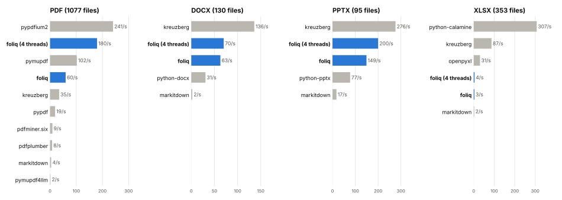

<p align="center">
  <a href="https://daniprol.github.io/foliq/">
    <picture>
      <source media="(prefers-color-scheme: dark)" srcset="https://raw.githubusercontent.com/daniprol/foliq/main/docs/assets/logo-wordmark-dark.svg">
      
    </picture>
  </a>
</p>

<p align="center">
  <strong>ripgrep for documents, made for AI agents.</strong><br>
  Search, read and cite PDF, Word, PowerPoint, Excel, HTML and Markdown files.<br>
  One local index, a Rust engine, a CLI and a Python API. No server, no API key.
</p>

<p align="center">
  <a href="https://github.com/daniprol/foliq/actions/workflows/ci.yml"></a>
  <a href="https://pypi.org/project/foliq/"></a>
  <a href="https://pypi.org/project/foliq/"></a>
  
  <a href="https://daniprol.github.io/foliq/"></a>
  <a href="https://github.com/daniprol/foliq/blob/main/LICENSE"></a>
</p>

<p align="center">
  <a href="https://daniprol.github.io/foliq/">Documentation</a> ·
  <a href="#quickstart">Quickstart</a> ·
  <a href="#give-it-to-your-agent">For agents</a> ·
  <a href="#python">Python</a> ·
  <a href="https://github.com/daniprol/foliq/tree/main/benchmarks">Benchmarks</a>
</p>

---

Coding agents are great at code because code is text: `grep` finds the line, then they read the
file around it. Documents break that loop. PDFs and Office files aren't text, and a whole report
doesn't fit in a prompt. foliq gives agents the same loop for documents: **find** a passage,
**read** exactly the section around it, and **cite** where it came from, all within a token budget.

```console
$ pip install foliq
$ foliq index papers/
synced: 4 added, 0 updated, 0 unchanged, 0 removed
  papers  4 documents, 281 chunks, 91475 tokens

$ foliq search "parallel attention layers heads" --limit 1
papers/attention.pdf#1.1 (p5, L131-143)  Attention Is All You Need > Abstract  [14.73]
    Multi-head attention allows the model to jointly attend to information from different
    representation subspaces at different positions. With a single attention head, averaging...

$ foliq read papers/attention.pdf#p5 --budget 800      # one page, or one section: #1.1
$ foliq context "why use multiple attention heads" --budget 1500
```

<sub>Real output, on four arXiv papers (Attention, BERT, RAG and chain-of-thought).</sub>

## Why foliq

- **Built for agents, not for chat UIs.** Every hit is a citation like
  `papers/attention.pdf#1.1 (p5, L131-143)`, and every citation is also a reference that `read`
  accepts. An agent goes from a search hit to the full section in one step, and quotes its source.
- **Answers that fit.** `outline` shows each section's size in tokens, `read --budget` stops on
  time, and `context --budget` packs the best passages (whole sections when they fit) into the
  budget you give it.
- **Never stale.** Every command syncs first, and only changed files are parsed again: modified
  time and size, then a content hash, then the parser and splitter versions decide.
- **Local and private.** One `.foliq/` folder with a SQLite index. No daemon, no embeddings API,
  no network. Access lists on documents are applied *before* ranking, so a search never leaks
  what its user may not see.
- **Fast where it counts.** Parsing, splitting, token counting and search run in Rust, on all
  cores. The Python package is a compiled extension with no Python dependencies.
- **Small core, everything pluggable.** Sources, parsers, splitters, stores and sinks are small
  Rust traits. Fill any of them from Rust, or from a plain Python class.

## Quickstart

```console
$ uvx foliq index ./docs                # try it without installing (or: pip install foliq)
$ foliq search "refund enterprise customers"
$ foliq outline docs/billing.pdf        # sections, with their sizes in tokens
$ foliq read docs/billing.pdf#2.3       # exactly one section
$ foliq context "how long do refunds take" --budget 1500
```

Copies of PDFs and Office files as Markdown live in `.foliq/text/`, so plain `grep` works on
them too. Add `--json` to any command for machine-readable output.

## Give it to your agent

```console
$ npx skills add daniprol/foliq   # any agent; or pnpm dlx / bunx
$ foliq skill --install --claude  # .agents/skills, linked from .claude/skills; --global for all
```

The [skill](https://github.com/daniprol/foliq/blob/main/skills/foliq/SKILL.md) teaches the agent to
search, outline, read and cite. No MCP server: the agent runs the `foliq` command.

## Python

```console
$ uv add foliq           # or: pip install foliq
```

```python
import foliq

index = foliq.Index(".foliq")
index.add("docs")
index.add("hr", access=["group:hr"])   # only principals in group:hr see these
index.sync()

for hit in index.search("refund policy", limit=5):
    print(hit["citation"], hit["title"])

index.read("docs/billing.pdf#2.3", budget=800)
index.context("how long do refunds take?", budget=1500)["text"]
```

### Tools for any agent framework

```python
tools = index.tools(principal="user:ana")              # sees only what user:ana may see
openai_tools = [tool.to_openai() for tool in tools]    # or .to_anthropic()
by_name = {tool.name: tool for tool in tools}
result_text = by_name[call.name].call_json(call.arguments)
```

Five tools (`search_documents`, `get_context`, `list_documents`, `outline_document`,
`read_document`), each a plain function with a JSON schema. The principal is bound when the tools
are made, so the model can never ask for someone else's documents.

### Plugins

A Python plugin is any object with the right method:

```python
class CsvParser:
    extensions = ("csv",)

    def parse(self, data: bytes, path: str) -> str:
        return csv_to_markdown(data)   # return Markdown; foliq finds the structure


class QdrantSink:
    def apply(self, changes: list[dict]) -> None:
        ...                            # every upsert and delete, after each sync


index = foliq.Index(parsers=[CsvParser()], sinks=[QdrantSink()])
```

Rust plugins implement the same traits as the built-ins (`Source`, `Parser`, `Splitter`, `Store`,
`Sink` in [`foliq-core`](https://github.com/daniprol/foliq/tree/main/crates/foliq-core)). The
engine never special-cases a built-in. See [Plugins](https://daniprol.github.io/foliq/plugins/).

## Benchmarks

Measured against the libraries people use today, on public corpora full of real and broken files,
with every number reproducible from one command
([method and all results](https://github.com/daniprol/foliq/tree/main/benchmarks)):

| | foliq | Others |
|---|---|---|
| **Word (.docx)**, files/s, one thread | **129** | Kreuzberg 129 · python-docx 35 · pandoc 3.1 · MarkItDown 2.1 |
| **PowerPoint (.pptx)**, files/s, one thread | **148** | Kreuzberg 269 · python-pptx 50 · MarkItDown 9.4 |
| **Excel (.xlsx)**, text quality | **76%** | openpyxl 72% · Kreuzberg 71% · MarkItDown 55% |
| **Broken PDFs**, failures out of 1,077 | **11** | PyMuPDF 14 · pypdfium2 24 · pypdf 34 |
| **Search** (BEIR SciFact), nDCG@10 | **0.688** | bm25s 0.686 · SQLite FTS5 0.682 · tantivy 0.668 |

foliq's times include the whole pipeline (parsing, splitting, token counting and indexing), not
just text extraction. Where it is behind, the benchmarks say so: Kreuzberg is faster on PowerPoint,
and PDF reading order (86% vs 95% for PyMuPDF) and single-thread PDF speed are the next things to
improve.

<p align="center">
  <picture>
    <source media="(prefers-color-scheme: dark)" srcset="https://raw.githubusercontent.com/daniprol/foliq/main/benchmarks/results/speed-dark.svg">
    
  </picture>
</p>

## How it works

```text
 Source ──► Parser ──────► Splitter ──► Store ──────► search · outline · read · context
 (folders)  (→ Markdown)   (→ chunks)   (SQLite FTS)
                                          └─────────► Sinks (Markdown mirror, your exports)
```

Every format becomes one Markdown text. Headings, tables and pages are found in that text, and
everything else (sections, chunks, citations) is a byte range of it. Sections are numbered like an
outline (`2.3`), so a search hit always knows its heading path, its lines and its pages. Read more
in [How it works](https://daniprol.github.io/foliq/how-it-works/).

| Format | Extensions | What foliq keeps |
|---|---|---|
| PDF | pdf | text per page, with page numbers ([pdf_oxide](https://crates.io/crates/pdf_oxide), pure Rust) |
| Word | docx | headings from styles, lists, tables |
| PowerPoint | pptx | one section per slide, with speaker notes |
| Excel, OpenDocument | xlsx, xlsm, xlsb, xls, ods | tables, dates, formulas, comments, per sheet |
| HTML | html, htm, xhtml | main content, headings, lists, tables |
| Markdown, text | md, markdown, mdx, txt, rst | as is |

Scanned PDFs need OCR, which is not built in yet.

## Status and roadmap

foliq is young (0.1, alpha) and its API may change. Version 0.1 has folders, SQLite full-text
search, the formats above, access rules, the CLI and the Python API, with prebuilt wheels for
Linux, macOS and Windows. Next: embeddings and hybrid search, an MCP server, cloud sources (S3,
Azure), Postgres, and Rust plugins shipped as Python wheels.

## Development

```console
uv sync                                   # tools, and builds the extension
uv run pytest                             # Python tests
scripts/cargo-test.sh --workspace         # Rust tests
uv run prek install                       # git hooks: ruff, ty, cargo fmt, clippy, tests
uv run --only-group docs zensical serve   # docs on http://localhost:8000
```

The Rust code is written to be read by Python developers: small files, plain names, and a comment
on every Rust idea a Python developer wouldn't know. [AGENTS.md](AGENTS.md) has the design and the
code style.

## License

[MIT](LICENSE)
