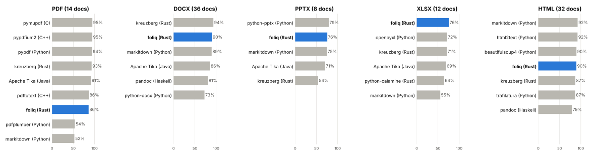
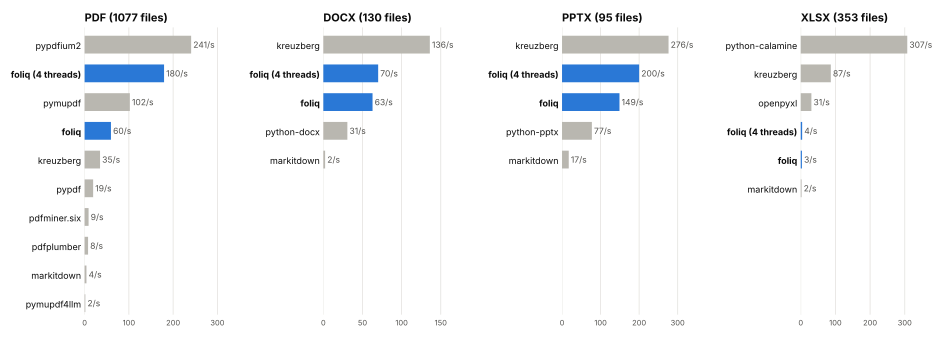
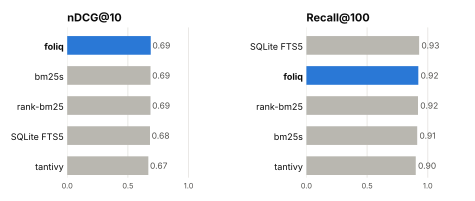
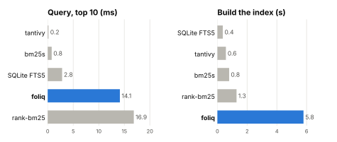

# foliq benchmarks

How foliq compares with popular libraries on **public, real-world documents**.
Every number below comes from the commands in the quickstart.

## Quickstart

```console
$ cd benchmarks
$ uv run python -m bench download   # public corpora at pinned commits, ~400 MB
$ uv run python -m bench all        # ~45 min on 4 cores; writes results/ and the charts
```

One benchmark at a time: `uv run python -m bench quality pdf docx`,
`... speed xlsx`, `... search`, `... charts`. The first `uv run` builds foliq
from this checkout, so it needs a Rust toolchain.

## Extraction quality

How close each library's text is to a reference text (100% = the same words in
the same order, markup ignored).

<picture>
  <source media="(prefers-color-scheme: dark)" srcset="results/quality-dark.svg">
  
</picture>

## Parsing speed

Files per second on corpora full of odd and broken files. One process, one file at a
time, 30 s limit per file. foliq's time is a full `Index.sync()`: parsing plus
splitting, token counting and the SQLite index.

<picture>
  <source media="(prefers-color-scheme: dark)" srcset="results/speed-dark.svg">
  
</picture>

## Search

BM25 on BEIR SciFact: 5,183 abstracts, 300 queries. One thread for everyone.

<picture>
  <source media="(prefers-color-scheme: dark)" srcset="results/search-quality-dark.svg">
  
</picture>

<picture>
  <source media="(prefers-color-scheme: dark)" srcset="results/search-speed-dark.svg">
  
</picture>

## Takeaways

- ✅ **Search quality is on par with the best BM25s** (nDCG@10 0.688, the
  published BM25 baseline is 0.665).
- ✅ **Office files are fast**: DOCX and PPTX at 60–200 files/s, 2x
  python-docx and python-pptx, 10–30x MarkItDown. Kreuzberg is faster still.
- ✅ **Fewest failures on broken PDFs** (11 of 1,077, PyMuPDF 14, pypdf 34).
- ⚠️ **PDF text order**: 86% on 14 PDFs (13 arXiv papers, one book) vs 95% for PyMuPDF and
  PDFium. foliq finds almost all the words (word F1 95% vs 96%), but puts
  figure labels and the arXiv margin stamp in the text flow, keeps
  hyphenated line ends (`num-bers`) and drops some math.
- ⚠️ **Single-PDF speed** is behind PDFium and MuPDF (C/C++). foliq makes up
  for it on many cores (180 files/s on 4).
- ⚠️ **Large spreadsheets are slow**: one 5,000-row sheet takes most of the
  XLSX time, in the splitter. Next to fix.
- ⚠️ **Queries take ~14 ms** vs ~1 ms for in-memory engines: each answer is a
  cited chunk read from SQLite, not just an id.

## What is compared

| Benchmark | Data | Compared with | Metric |
|---|---|---|---|
| PDF quality | [py-pdf/benchmarks](https://github.com/py-pdf/benchmarks): 14 PDFs with hand-checked text¹ | PyMuPDF, pymupdf4llm, pypdfium2, pypdf, pdfplumber, pdfminer.six, MarkItDown, Kreuzberg | edit similarity |
| DOCX, PPTX, XLSX, HTML quality | [docling](https://github.com/docling-project/docling) test files with their reviewed Markdown² | python-docx, python-pptx, openpyxl, python-calamine, html2text, trafilatura, BeautifulSoup, MarkItDown, Kreuzberg | edit similarity |
| PDF speed | [pdf.js](https://github.com/mozilla/pdf.js) test suite: 1,077 PDFs | same as PDF quality | files/s, failures |
| Office speed | [Apache POI](https://github.com/apache/poi) test files: 130 DOCX, 95 PPTX, 353 XLSX | same as Office quality | files/s, failures |
| Search | [BEIR SciFact](https://github.com/allenai/scifact) | bm25s, tantivy, rank-bm25, SQLite FTS5 | nDCG@10, Recall@100, ms/query |

¹ 13 arXiv papers and one LaTeX book. Where arXiv can't be reached, only
the book is scored (the chart shows how many were used).
² docling made these references, so docling itself is left out; it also
needs PyTorch, which is too heavy for a quick benchmark.

## Fair play

- Default options for every library, Markdown output when it has one, no OCR.
- Every library gets the same files from the same folder, in its own process
  (imports and warm-up are not timed).
- Failures are exceptions, crashes and timeouts. Many test files are broken
  or encrypted on purpose, so every library fails some.
- Raw numbers (and per-document quality scores) are in [`results/`](results/).

Run on a 4-core Intel Xeon (2.8 GHz) cloud VM, Linux, Python 3.13. Versions:
PyMuPDF 2.0, pymupdf4llm 2.0, pypdfium2 5.14, pypdf 6.21, pdfplumber 0.11,
pdfminer.six 20260107, MarkItDown 0.1.9, Kreuzberg 4.10, python-docx 1.2,
python-pptx 1.0, openpyxl 3.1, python-calamine 0.9, html2text 2025.4,
trafilatura 2.3, BeautifulSoup 4.15, bm25s 0.3, rank-bm25 0.2, tantivy 0.27
(pinned in `uv.lock`).
