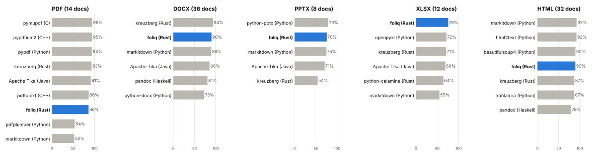
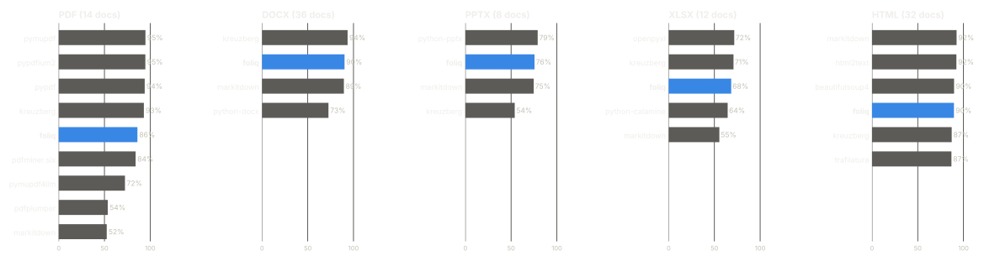
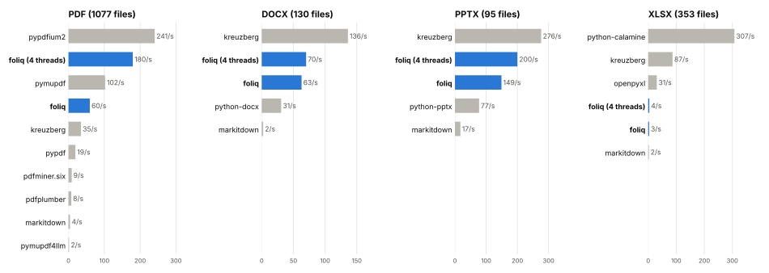
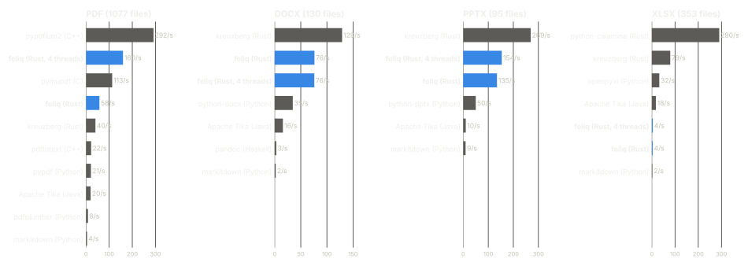
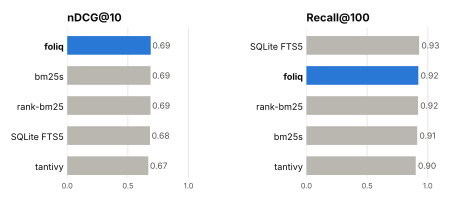
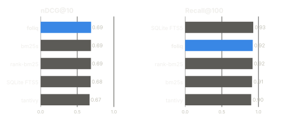

# Benchmarks

foliq against the libraries people use today, on public documents full of real
and broken files. Every number comes from one command in the
[benchmarks folder](https://github.com/daniprol/foliq/tree/main/benchmarks),
which also has the method, the versions and the raw results.

| | foliq | Others |
|---|---|---|
| **Word (.docx)**, files/s, one thread | **129** | Kreuzberg 129 · python-docx 35 · pandoc 3.1 · MarkItDown 2.1 |
| **PowerPoint (.pptx)**, files/s, one thread | **148** | Kreuzberg 269 · python-pptx 50 · MarkItDown 9.4 |
| **Excel (.xlsx)**, text quality | **76%** | openpyxl 72% · Kreuzberg 71% · MarkItDown 55% |
| **Broken PDFs**, failures out of 1,077 | **11** | PyMuPDF 14 · pypdfium2 24 · pypdf 34 |
| **Search** (BEIR SciFact), nDCG@10 | **0.688** | bm25s 0.686 · SQLite FTS5 0.682 · tantivy 0.668 |

foliq's times are a full `Index.sync()`: parsing, splitting, token counting and
the SQLite index, not just text extraction.

## Extraction quality

How close each library's text is to a reference text (100% means the same words
in the same order, markup ignored).

## Parsing speed

Files per second, one process, one file at a time, 30 s limit per file.

## Search

BM25 on BEIR SciFact: 5,183 abstracts and 300 queries, one thread for everyone.

## Where foliq is behind

- **PDF text order**: 86% on 14 PDFs, against 95% for PyMuPDF and PDFium. foliq
  finds almost all the words (word F1 95% vs 96%), but puts figure labels in
  the text flow, keeps hyphenated line ends and drops some math.
- **Single-PDF speed**: about half PyMuPDF's rate on one thread. On 4 cores
  foliq reaches 160 files/s.
- **XLSX speed**: 27 files/s on one thread, behind python-calamine and
  Kreuzberg, which only extract text.
- **Query time**: about 14 ms, against about 1 ms for in-memory engines, since
  each answer is a cited chunk read from SQLite, not just an id.
